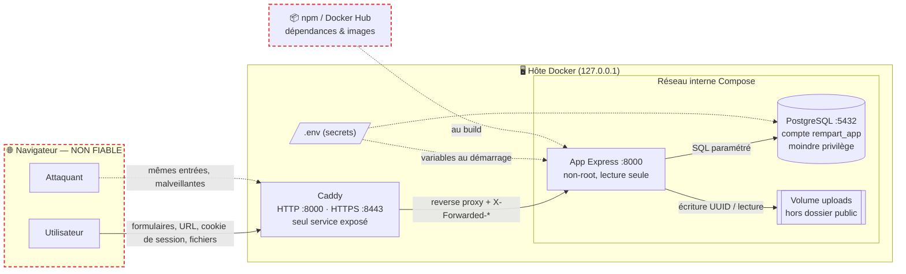

# 🛡️ Rempart

Application web développée « secure by design » dans le cadre du module Cyber Sécurité (B3 DEV), en suivant l'[OWASP Top 10:2025](https://top10.owasp.org/2025/).

**Sujet (à valider) :** un coffre-fort en ligne. Chaque utilisateur s'inscrit et range ses **notes** et ses **fichiers** privés ; personne d'autre n'y a accès. Un rôle **admin** supervise les comptes. Évolution prévue : des espaces partagés entre plusieurs membres.

**Stack :** Node.js 22 + Express · PostgreSQL 17 · Caddy (HTTPS local) · Docker Compose.

---

## Démarrage rapide

```bash
brew install mkcert
mkcert -install
mkdir -p certs
mkcert -cert-file certs/localhost.pem -key-file certs/localhost-key.pem localhost 127.0.0.1 ::1
cp .env.example .env
docker compose up -d --build
```

`mkcert -install` ajoute une autorité de certification locale au trousseau du système (mot de passe demandé) : le navigateur reconnaît alors le certificat sans avertissement. Le dossier `certs/` contient la clé privée : il est ignoré par Git et par Docker.

Remplir les deux mots de passe de `.env` avant le premier lancement, par exemple avec `openssl rand -hex 24`. Ils sont vides dans `.env.example` : Compose refuse de démarrer tant qu'ils manquent.

Pour obtenir un compte admin : s'inscrire sur `/register`, puis lancer `./src/scripts/promote-admin.sh moi@exemple.fr`.

| URL                             | Rôle                                                                                       |
| ------------------------------- | ------------------------------------------------------------------------------------------ |
| https://localhost:8443          | **Adresse à utiliser dans le navigateur.** Mes notes (redirige vers `/login` sans session) |
| https://localhost:8443/register | Inscription                                                                                |
| https://localhost:8443/admin    | Administration (rôle admin uniquement)                                                     |
| https://localhost:8443/account  | Mon compte : résumé des données et suppression du compte                                   |
| http://localhost:8000           | Redirige en `308` vers https://localhost:8443 (même chemin)                                |
| https://localhost:8443/health   | Vérifie l'app **et** la base (`200 {"db":"up"}` ou `503 {"db":"down"}`)                    |

**Pourquoi HTTPS en local :** le cookie de session porte le drapeau `Secure`. Chrome et Firefox l'acceptent sur `http://localhost`, mais **Safari le refuse** : la connexion réussit côté serveur, puis Safari jette le cookie et l'utilisateur revient sur `/login`. Caddy sert donc l'app en HTTPS avec un certificat mkcert, redirige tout le HTTP vers HTTPS et envoie `Strict-Transport-Security` (voir [10. HTTPS et HSTS](#10-https-et-hsts)).

### Commandes utiles

| Commande                                                                 | Effet                                              |
| ------------------------------------------------------------------------ | -------------------------------------------------- |
| `docker compose up -d --build`                                           | Construit et lance app + base                      |
| `docker compose logs -f app`                                             | Suit les logs de l'app                             |
| `docker compose ps`                                                      | État et healthchecks des conteneurs                |
| `docker compose down`                                                    | Arrête (les données restent dans le volume)        |
| `docker compose down -v`                                                 | Arrête **et efface** la base                       |
| `docker compose exec db sh -c 'psql -U "$POSTGRES_USER" "$POSTGRES_DB"'` | Console SQL (admin)                                |
| `./src/scripts/promote-admin.sh <email>`                                 | Donne le rôle admin à un compte existant           |
| `npm test`                                                               | Tests unitaires et tests d'intégration automatisés |
| `./src/scripts/proofs.sh`                                                | Lance toutes les vérifications de sécurité         |

### Variables d'environnement

Définies dans `.env` (jamais commité ; modèle : `.env.example`).

| Variable            | Exemple         | Description                                                                                           |
| ------------------- | --------------- | ----------------------------------------------------------------------------------------------------- |
| `POSTGRES_USER`     | `rempart_admin` | Compte **administrateur** de la base : sert uniquement à l'initialisation, jamais à l'app             |
| `POSTGRES_PASSWORD` | _(vide)_        | Mot de passe admin, à générer avec `openssl rand -hex 24`. Obligatoire                                |
| `POSTGRES_DB`       | `rempart`       | Nom de la base                                                                                        |
| `APP_DB_USER`       | `rempart_app`   | Compte **applicatif** au moindre privilège, le seul utilisé par l'app                                 |
| `APP_DB_PASSWORD`   | _(vide)_        | Mot de passe du compte applicatif, généré de la même façon. Obligatoire                               |
| `COOKIE_SECURE`     | `true`          | Drapeau `Secure` du cookie de session. Toujours laisser à `true` et passer par https://localhost:8443 |

Le conteneur `app` ne reçoit que les identifiants du compte applicatif (`compose.yaml`) : le mot de passe admin ne lui est jamais transmis. `NODE_ENV=production` y est forcé.

⚠️ Le script `db/init/01-init.sh` ne s'exécute que sur un volume vide : après un changement de schéma, lancer `docker compose down -v`.

### Structure

```
.
├── compose.yaml          proxy + app + db ; seul le proxy est exposé, app en lecture seule
├── Caddyfile             HTTPS (certificat mkcert), HSTS, HTTP redirigé vers HTTPS
├── certs/                certificat et clé mkcert (non versionnés)
├── Dockerfile            node:22-alpine, utilisateur non-root
├── db/init/01-init.sh    schéma + compte applicatif au moindre privilège
├── src/
│   ├── auth/             password, session, totp
│   ├── config/db.js      pool PostgreSQL
│   ├── middleware/       access, rate-limit, security, upload
│   ├── lib/              errors, format
│   ├── repository/       accès SQL par domaine
│   ├── services/         logique métier routes → services → repositories
│   ├── routes/           contrôleurs HTTP + route /health
│   ├── views/            templates EJS
│   └── server.js         assemblage Express
├── public/style.css
├── tests/
│   ├── unit/             tests unitaires
│   └── integration/      tests HTTP des charges d'attaque
└── src/scripts/
    ├── proofs.sh         vérifie toutes les protections ci-dessous
    └── promote-admin.sh  attribue le rôle admin
```

### Tests automatisés

```bash
npm test
```

`tests/integration/attaques.test.js` utilise le lanceur intégré de Node (`node:test`), sans aucune dépendance. Il vise l'app qui tourne (`BASE_URL`, par défaut `https://localhost:8443`, autorité mkcert passée par `NODE_EXTRA_CA_CERTS`). Avant les tests, il crée un compte jetable et s'y connecte. Chaque test envoie ensuite une charge d'attaque et vérifie seul qu'elle échoue :

| Test            | Charge envoyée                                                                    | Résultat attendu                                                                                       |
| --------------- | --------------------------------------------------------------------------------- | ------------------------------------------------------------------------------------------------------ |
| Injection SQL   | `' OR '1'='1` dans la recherche, après avoir créé une note témoin                 | `200`, « 0 résultat(s) », la note témoin n'apparaît pas                                                |
| XSS             | Note titrée `` et contenu `<script>alert(2)</script>` | Les deux ressortent en `&lt;…&gt;`, aucune balise brute dans la page, CSP `script-src 'none'` présente |
| Upload interdit | `shell.php`, `image.svg`, et un SVG renommé `deguise.png`                         | `415` pour chacun, « Type de fichier refusé », rien n'est ajouté à la liste                            |

```
✔ injection SQL : ' OR '1'='1 dans la recherche ne renvoie aucune note
✔ XSS :  ressort échappé
✔ upload : un .php et un .svg sont refusés
ℹ pass 3
ℹ fail 0
```

**Les tests détectent vraiment une faille.** En remplaçant `<%= note.title %>` par `<%- note.title %>` (sortie non échappée) dans `views/notes.ejs`, le test XSS passe au rouge (`✖`). Il redevient vert une fois l'échappement remis.

### Vérifier les protections

```bash
./src/scripts/proofs.sh
```

Le script lance 101 attaques et vérifications contre l'app qui tourne, en HTTPS. Il couvre la suppression de compte, les secrets (gitleaks), HTTPS et HSTS, les en-têtes de sécurité, CORS, l'injection SQL, les droits du compte DB, XSS, CSP, l'upload, les mots de passe, l'authentification, les sessions, l'autorisation, l'IDOR, le mass assignment, la limitation des tentatives et les erreurs.

Il crée des comptes de test, coupe brièvement la base pour provoquer une erreur 500, puis redémarre l'app pour remettre les compteurs de tentatives à zéro.

---

## Gestion des secrets

Les secrets ne sont jamais dans le dépôt :

| Secret                                 | Où il vit                                                                  | Protection                                                          |
| -------------------------------------- | -------------------------------------------------------------------------- | ------------------------------------------------------------------- |
| Mots de passe PostgreSQL               | `.env` (droits `600`)                                                      | `.gitignore` et `.dockerignore`                                     |
| Clé privée TLS (`localhost-key.pem`)   | `certs/` (droits `600`), monté en lecture seule dans Caddy                 | `.gitignore` et `.dockerignore`                                     |
| Clé de l'autorité mkcert (`rootCA-key.pem`) | `~/Library/Application Support/mkcert`, hors du projet                | Jamais copiée dans le projet                                        |

`.env.example` est le seul modèle versionné. Il liste toutes les variables, mais **les mots de passe y sont vides** : aucune valeur réelle, ni même un mot de passe faible par défaut. `compose.yaml` exige les deux mots de passe (`${APP_DB_PASSWORD:?…}`). Un `.env` incomplet bloque donc le démarrage, au lieu de lancer une base sans mot de passe solide.

**gitleaks sur tout l'historique : aucun constat.**

```
$ gitleaks git . --redact -v
INF 1 commits scanned.
INF scanned ~194159 bytes (194.16 KB)
INF no leaks found
```

Le dossier n'a plus de dépôt Git propre (il a été retiré avant le rendu). Le script de preuves crée donc un dépôt temporaire, y commite tout ce que `.gitignore` laisse passer (54 fichiers), puis lance `gitleaks git` dessus. Le résultat est exactement ce qu'un `git add -A && git commit` publierait. Aucune rotation n'a été nécessaire : aucun secret n'a jamais été suivi.

Le scan vérifie vraiment quelque chose : dans un dépôt de test où `.env` et `certs/` ne sont pas ignorés, gitleaks signale `private-key` sur `certs/localhost-key.pem`. À l'inverse, `gitleaks dir .` sur le dossier de travail trouve bien `.env` et la clé : ils existent sur le disque, mais Git ne les voit pas.

**Preuve que `.env` et les clés sont ignorés :**

```bash
git check-ignore -v .env certs/localhost-key.pem
# .gitignore:1:.env     .env
# .gitignore:6:certs/   certs/localhost-key.pem
git ls-files | grep -E '\.env$|\.pem$'   # → rien
```

**Et si un secret a déjà été poussé une fois ?** L'ajouter au `.gitignore` après coup ne suffit pas : il reste dans l'historique Git, dans tous les clones et forks, et potentiellement déjà aspiré par des bots qui scannent GitHub en continu. Il faut considérer le secret comme **compromis** :

1. **Révoquer / changer le secret immédiatement** (c'est la seule vraie parade).
2. Retirer le fichier du suivi : `git rm --cached .env`, puis commit.
3. Purger l'historique (`git filter-repo --path .env --invert-paths` ou BFG) puis `git push --force`, et demander aux collaborateurs de re-cloner.
4. Vérifier les logs d'accès du service concerné pour détecter un usage frauduleux.
5. Prévenir la récidive : scan de secrets (GitHub Secret Scanning / push protection, `gitleaks` en pre-commit).

---

## Sécurité

### Schéma des flux et frontières de confiance



**Frontières de confiance** (là où une donnée change de niveau de confiance et doit être contrôlée) :

| #   | Frontière                 | Ce qui la traverse          | Contrôle attendu                                                                                                     |
| --- | ------------------------- | --------------------------- | -------------------------------------------------------------------------------------------------------------------- |
| FC1 | Navigateur → Caddy → App  | Toutes les requêtes HTTP(S) | TLS, authentification, validation des entrées, contrôle d'accès, limitation de débit, refus des POST d'un autre site |
| FC2 | App → Base                | Requêtes SQL                | Requêtes paramétrées, compte DB à privilèges minimaux                                                                |
| FC3 | App → Système de fichiers | Fichiers uploadés           | Nom regénéré côté serveur, type/taille vérifiés, hors racine web                                                     |
| FC4 | Supply chain → Build      | Paquets npm, image de base  | Lockfile, `npm audit`, versions épinglées                                                                            |
| FC5 | Hôte → Conteneurs         | Secrets `.env`              | `.env` hors Git, droits 600, aucun secret dans l'image                                                               |

### Surfaces d'entrée

| Surface           | Exemples (actuels ou prévus)                                             | Risque principal                                                            |
| ----------------- | ------------------------------------------------------------------------ | --------------------------------------------------------------------------- |
| **Formulaires**   | inscription, connexion, création de note, invitation d'un membre         | Injection SQL, XSS stockée, brute-force                                     |
| **URL**           | `/spaces/:id`, `/notes/:id`, `?q=` recherche, `?redirect=`               | IDOR, open redirect, injection                                              |
| **Cookies**       | cookie de session                                                        | Vol (XSS), fixation, CSRF                                                   |
| **En-têtes HTTP** | `Host`, `X-Forwarded-For`, `User-Agent`                                  | Contournement du rate-limit, injection de logs                              |
| **Fichiers**      | pièces jointes uploadées                                                 | Path traversal, fichier exécutable / HTML servi, déni de service par taille |
| **API JSON**      | endpoints `fetch` du front, `/health`                                    | Mass assignment, divulgation d'infos                                        |
| **Dépendances**   | `express`, `pg` et leurs dépendances transitives, image `node:22-alpine` | Paquet vulnérable ou compromis                                              |
| **Configuration** | `.env`, `compose.yaml`                                                   | Secret fuité, base exposée                                                  |

### Cinq menaces classées

Classement par risque (probabilité × impact) sur ce projet.

| Rang  | Menace                                                           | OWASP 2025                                                         | Scénario d'attaque                                                                                               | Première parade                                                                                                                                                                                                  |
| ----- | ---------------------------------------------------------------- | ------------------------------------------------------------------ | ---------------------------------------------------------------------------------------------------------------- | ---------------------------------------------------------------------------------------------------------------------------------------------------------------------------------------------------------------- |
| **1** | **Contrôle d'accès cassé (IDOR)**                                | A01 Broken Access Control                                          | Un membre change `/notes/42` en `/notes/43` et lit la note d'un autre espace.                                    | Vérifier côté serveur, **à chaque requête**, que la ressource appartient à un espace dont l'utilisateur est membre (`WHERE id=$1 AND space_id IN (…user…)`). Refus par défaut.                                   |
| **2** | **Injection SQL**                                                | A05 Injection                                                      | Recherche `?q=' OR 1=1--` qui renvoie toutes les notes, ou dump de la table `users`.                             | **Uniquement des requêtes paramétrées** (`pool.query(sql, [params])`), jamais de concaténation. Compte DB sans droits DDL.                                                                                       |
| **3** | **Prise de compte (auth faible / brute-force / vol de session)** | A07 Authentication Failures                                        | Credential stuffing sur `/login`, ou vol du cookie de session via XSS.                                           | Hash **argon2id/bcrypt**, rate-limit + verrouillage progressif, cookie `HttpOnly; Secure; SameSite=Lax`, régénération de l'ID de session à la connexion.                                                         |
| **4** | **Upload de fichier malveillant**                                | A01 / A05 / A06 Insecure Design                                    | Upload de `../../app/src/server.js` (path traversal) ou d'un `.html` contenant du JS servi sur le domaine (XSS). | Nom de fichier = UUID généré serveur, stockage hors du dossier servi, liste blanche de types (magic bytes), taille max, téléchargement en `Content-Disposition: attachment` + `X-Content-Type-Options: nosniff`. |
| **5** | **Dépendance vulnérable ou secret exposé**                       | A03 Software Supply Chain Failures / A02 Security Misconfiguration | Un paquet npm compromis exfiltre `process.env`, ou `.env` est poussé sur GitHub.                                 | `package-lock.json` + `npm ci`, `npm audit` / Dependabot, `.env` ignoré + scan de secrets, base non exposée, conteneur non-root.                                                                                 |

### Socle

- `.env` ignoré par Git et par Docker (`.gitignore`, `.dockerignore`) ; seul `.env.example` est versionné.
- PostgreSQL et l'app **ne sont pas exposés** à l'hôte : seul Caddy l'est, sur `127.0.0.1:8000` (HTTP, redirigé vers HTTPS) et `127.0.0.1:8443` (HTTPS), et il ne fait que relayer vers l'app. L'en-tête `Server` est retiré.
- `trust proxy` est limité aux adresses de réseau privé (`uniquelocal`). Comme seul Caddy peut joindre l'app, l'IP fournie par `X-Forwarded-For` est fiable : la limitation des tentatives voit la vraie IP du client.
- Conteneur app : utilisateur **non-root**, système de fichiers en **lecture seule** (sauf le volume d'uploads et `/tmp`), `cap_drop: ALL`, `no-new-privileges`.
- `npm ci` sur lockfile, dépendances de production uniquement ; `X-Powered-By` désactivé.
- Une coupure de la base ne fait pas tomber l'app : `/health` répond `503`, puis revient à `200`.

### 1. Injection SQL : requêtes paramétrées

Toutes les requêtes passent par `pool.query(texte, valeurs)` : la donnée part séparément du texte SQL, PostgreSQL ne l'interprète jamais comme du code.

```js
// src/routes/notes.js
await query("INSERT INTO notes (title, body) VALUES ($1, $2)", [
  form.title,
  form.body,
]);

// src/routes/files.js
await query("SELECT id, original_name, mime FROM files WHERE id = $1", [
  req.params.id,
]);
```

**Recherche (bonus).** Elle est paramétrée elle aussi. Les jokers `%` et `_` saisis par l'utilisateur sont échappés pour rester des caractères littéraux :

```js
WHERE title ILIKE $1 ESCAPE '\' OR body ILIKE $1 ESCAPE '\'
[`%${escapeLike(search)}%`]
```

**Preuves :**

- `' OR '1'='1` saisi dans la recherche renvoie « 0 résultat(s) ».
- `%` ne renvoie rien non plus.
- Une note titrée `x'); DROP TABLE notes; --` est stockée telle quelle et la table reste intacte.

**Moindre privilège.** L'app se connecte avec `rempart_app` (`db/init/01-init.sh`). Ce compte n'est ni superuser, ni créateur de bases ou de rôles. Il n'a que `CONNECT` sur la base, `USAGE` sur le schéma et `SELECT, INSERT` sur `notes` et `files`. Les droits par défaut de `PUBLIC` sont révoqués. Même une injection réussie ne pourrait donc ni supprimer, ni modifier, ni créer de table, ni lire `pg_authid`. Le script le vérifie :

```bash
docker compose exec db sh -c 'psql -U "$APP_DB_USER" -d "$POSTGRES_DB" -c "DROP TABLE notes"'
# ERROR:  must be owner of table notes
```

### 2. XSS : échappement selon le contexte de sortie

- Le rendu passe par EJS, avec `<%= … %>` partout. EJS échappe `& < > " '`, ce qui couvre le contexte texte HTML et le contexte attribut entre guillemets, par exemple `value="<%= form.title %>"`.
- `<%-` (sortie brute) n'est utilisé que pour `include` de partials statiques, jamais pour une donnée utilisateur.
- Aucun JavaScript côté client : aucun sink `innerHTML` à protéger.
- **Preuve :** `` saisi s'affiche en toutes lettres. Le HTML contient `&lt;img src=x onerror=alert(1)&gt;`.
- **HTML riche :** non nécessaire, les notes sont du texte brut (mise en forme par `white-space: pre-wrap`). DOMPurify serait donc une dépendance sans usage. Si un éditeur riche est ajouté, le HTML sera nettoyé par DOMPurify, côté serveur, avant stockage.
- **CSP (bonus)**, posée sur toutes les pages (`src/middleware/security.js`) :
  ```
  default-src 'none'; script-src 'none'; style-src 'self'; img-src 'self' data:;
  form-action 'self'; base-uri 'none'; frame-ancestors 'none'
  ```
  Même si un échappement manquait, le navigateur refuserait d'exécuter le moindre script. Le détail de chaque en-tête est dans [11. En-têtes de sécurité HTTP](#11-en-têtes-de-sécurité-http).

### 3. Upload de fichiers

| Contrôle            | Implémentation (`src/middleware/upload.js`, `src/services/files.js`)                                                                                                                                                          |
| ------------------- | ----------------------------------------------------------------------------------------------------------------------------------------------------------------------------------------------------------------------------- |
| Liste blanche       | PNG, JPEG, PDF uniquement                                                                                                                                                                                                     |
| Contenu vérifié     | Signature binaire (_magic bytes_) lue dans le fichier **et** extension cohérente avec cette signature                                                                                                                         |
| Renommage           | Stocké sous un UUID v4 généré serveur, sans extension (`flag: "wx"`, `mode: 0o600`) ; le nom d'origine est nettoyé (`basename`, caractères filtrés, 100 max) et sert seulement d'étiquette                                    |
| Taille max          | 2 Mo (`multer` `limits.fileSize`) → `413` ; 1 fichier, nombre de champs limité                                                                                                                                                |
| Hors dossier public | Volume `/data/uploads`, distinct de `public/` : aucune URL directe vers un fichier                                                                                                                                            |
| Service sûr         | `/files/:id` (UUID validé, puis recherche en base) → `Content-Disposition: attachment`, `X-Content-Type-Options: nosniff`, `Content-Type` issu de la détection, `CSP: default-src 'none'; sandbox`, `Cache-Control: no-store` |

**Preuves** (réponse `415`) :

- `shell.php` est refusé ;
- `image.svg` est refusé ;
- un SVG renommé `.png` est refusé, car son contenu est vérifié ;
- un `.php` commençant par une signature PNG est refusé, car son extension est vérifiée.

Un fichier de plus de 2 Mo est refusé en `413`. Un PNG envoyé sous le nom `../../etc/passwd.png` est accepté et téléchargé sous `passwd.png`.

### 4. Gestion des erreurs

- Toutes les erreurs aboutissent dans un gestionnaire unique (`src/lib/errors.js`). Express 5 y transmet aussi les erreurs des routes `async`.
- **Côté utilisateur**, la page est générique : message neutre selon le statut (400, 404, 413 ou 500), plus une **référence** courte. Elle n'affiche ni trace, ni message SQL, ni chemin de fichier.
- **Côté serveur**, une ligne JSON est journalisée avec la référence, le statut, la méthode, le chemin, le message et la stack. La référence permet de relier un signalement utilisateur au journal (`docker compose logs app | grep <ref>`).
- **Debug** : le détail technique n'apparaît dans la page que si `NODE_ENV=development` est défini explicitement. Sans variable, l'app démarre en `production` : en cas d'oubli, c'est le mode sûr qui s'applique. Compose et le Dockerfile forcent `production`.
- **Preuve :** avec la base coupée, `/` répond `500` avec « Une erreur est survenue », sans `ECONNREFUSED` ni stack. Le journal contient la stack complète sous la même référence.

---

### 5. Stockage des mots de passe

- Inscription, connexion et déconnexion : `src/routes/auth.js`.
- Hachage **Argon2id** (`src/auth/password.js`), avec les paramètres minimaux recommandés par OWASP : 19 Mio de mémoire, 2 itérations, parallélisme 1. Le **sel** est aléatoire et propre à chaque hash, il est inclus dans la chaîne stockée.
- Ce qui se voit en base :
  ```
  $argon2id$v=19$m=19456,t=2,p=1$<sel base64>$<hash base64>
  ```
- La base refuse tout autre format : `CHECK (password_hash LIKE '$argon2id$%')`.
- **Aucun mot de passe en clair :**
  - le mot de passe n'est jamais stocké, jamais renvoyé dans un formulaire (le champ reste vide après une erreur) et jamais journalisé ;
  - les journaux d'auth ne contiennent que l'événement, l'e-mail ou l'id, et l'IP ;
  - le script vérifie l'absence du mot de passe de test en base et dans `docker compose logs`.
- Longueur maximale : 128 caractères, pour éviter un déni de service par hachage de très longues chaînes.

### 6. Authentification

**Message identique :**

- Un e-mail inconnu et un mauvais mot de passe donnent le même statut (`401`) et le même texte : « E-mail ou mot de passe incorrect. »
- Le temps de réponse est aussi le même : si l'e-mail est inconnu, un Argon2 est quand même calculé sur un hash factice.
- L'**inscription** ne révèle pas non plus si une adresse existe déjà. La réponse est toujours la même redirection, avec « Si cette adresse n'était pas déjà utilisée, votre compte est créé », et le hachage est fait dans les deux cas.

**Limitation des tentatives** (`src/middleware/rate-limit.js`, fenêtre glissante de 15 min) :

| Clé              | Limite    | Effet                                                               |
| ---------------- | --------- | ------------------------------------------------------------------- |
| Compte (e-mail)  | 5 échecs  | `429` + `Retry-After`, même avec le bon mot de passe                |
| IP               | 20 échecs | `429`, quel que soit le compte visé (contre le _password spraying_) |
| IP (inscription) | 10 essais | `429`                                                               |

Les e-mails inconnus sont comptés comme les autres : le blocage ne révèle donc pas si un compte existe.

Le script prouve les trois cas :

- après 5 échecs, le bon mot de passe est refusé en `429` ;
- un autre compte reste accessible ;
- au bout de 20 échecs cumulés depuis la même IP, sur des comptes tous différents, la réponse est `429`.

**Limites assumées :**

- Les compteurs sont en mémoire : ils repartent à zéro à chaque redémarrage et ne tiennent que pour une seule instance. En production, il faudrait les mettre dans Redis ou en base.
- Le blocage par compte permet de gêner un utilisateur légitime pendant 15 min ; la fenêtre courte limite ce risque.

**Longueur plutôt que complexité :** il faut au moins 6 caractères, sans exigence de majuscule, de chiffre ou de symbole. Le script vérifie que 5 caractères sont refusés et que `abcdef` est accepté. Le formulaire invite à choisir une phrase de passe.

⚠️ OWASP et le NIST SP 800-63B recommandent **au moins 8 caractères**, et 15 sans authentification à deux facteurs. Le minimum de 6 est un choix du projet. Pour durcir, il suffit de changer `MIN_LENGTH` dans `src/auth/password.js`.

### 7. Sessions

Les sessions sont gérées côté serveur (`src/auth/session.js`, table `sessions`), sans bibliothèque, pour maîtriser chaque propriété.

| Exigence     | Implémentation                                                                                                                                                                       |
| ------------ | ------------------------------------------------------------------------------------------------------------------------------------------------------------------------------------ |
| Cookie       | `rempart_sid=…; HttpOnly; Secure; SameSite=Lax; Path=/; Max-Age=28800`                                                                                                               |
| Identifiant  | 256 bits aléatoires (`crypto.randomBytes(32)`) ; **seul son SHA-256 est stocké** en base : une fuite de la table ne permet pas de voler les sessions                                 |
| Régénération | À chaque connexion, l'ancienne session est supprimée et un nouvel identifiant est émis. Un identifiant imposé par un attaquant (_fixation_) est donc remplacé                        |
| Logout       | `POST /logout` supprime la ligne en base et efface le cookie. Rejouer l'ancien cookie ramène à `/login`                                                                              |
| Expiration   | Absolue : 8 h (`expires_at`). Inactivité : 30 min (`last_seen_at`). Toutes deux sont vérifiées côté serveur à chaque requête ; les sessions expirées sont purgées à chaque connexion |
| Cache        | `Cache-Control: no-store` sur toute page authentifiée                                                                                                                                |

**CSRF :**

- Les formulaires sont en `POST`, et `SameSite=Lax` empêche l'envoi du cookie depuis un autre site.
- En plus, `sameOriginOnly` refuse en `403` tout `POST` dont `Sec-Fetch-Site` ou `Origin` désigne un autre site.
- Piège rencontré : avec `Referrer-Policy: no-referrer`, les navigateurs envoient `Origin: null` sur les formulaires, et les POST légitimes étaient refusés. Correction : `Referrer-Policy: same-origin`. Ce cas est couvert par le script de preuves.

### 8. Autorisation : rôles et refus par défaut

- Deux rôles, `user` et `admin`, définis dans la colonne `users.role` avec `CHECK (role IN ('user', 'admin'))`.
- **Personne ne peut se donner le rôle admin depuis l'app** : le compte DB applicatif n'a pas le droit `UPDATE` sur `users`, et son droit `INSERT` est limité aux colonnes `email` et `password_hash`. La promotion passe par `scripts/promote-admin.sh`, qui utilise le compte DB administrateur.
- **Refus côté serveur** : le routeur `/admin` commence par `router.use(requireRole("admin"))`.
  - Un utilisateur connecté qui appelle `/admin` reçoit `403`.
  - Un visiteur anonyme est redirigé vers `/login`.
  - Le lien « Admin » est aussi masqué dans le menu, mais ce n'est qu'un confort : la protection est sur le serveur.
- **Refus par défaut** (`src/server.js`) :
  ```js
  app.use(authRouter); // seules routes publiques : /login, /register, /logout
  app.use(requireAuth); // tout ce qui est déclaré après exige une session
  app.use(notesRouter);
  app.use(filesRouter);
  app.use("/admin", adminRouter);
  ```
  Une route ajoutée plus tard est donc fermée tant qu'on ne la déclare pas explicitement avant `requireAuth`. Le script le vérifie : `/route-pas-encore-ecrite` en anonyme redirige vers `/login`, et un `POST` anonyme reçoit `401`.

### 9. IDOR et mass assignment

**Chaque requête filtre sur le propriétaire.** L'identifiant de l'utilisateur vient de la session, jamais de la requête :

```js
("SELECT … FROM notes WHERE id = $1 AND owner_id = $2",
  [req.params.id, req.user.id]);
("UPDATE notes SET title = $1, body = $2, updated_at = now() WHERE id = $3 AND owner_id = $4");
("DELETE FROM files WHERE id = $1 AND owner_id = $2 RETURNING id");
```

Une ressource qui appartient à un autre compte renvoie **404** : on ne confirme même pas qu'elle existe.

Preuve avec deux comptes, alice et bob :

- alice lit `/notes/4` et obtient `200` ;
- bob reçoit `404` en lisant, en modifiant ou en supprimant cette note, qui reste inchangée en base ;
- bob reçoit `404` en téléchargeant ou en supprimant le fichier d'alice ;
- la liste et la recherche de bob ne montrent rien d'alice.

**Pas de mass assignment :**

- Les formulaires sont lus champ par champ (`readNoteForm` ne garde que `title` et `body`). Jamais d'`INSERT … ${Object.keys(req.body)}`.
- Le script envoie `owner_id`, `id` et `created_at` en plus du titre : ils sont ignorés et la note appartient bien à alice.
- `role=admin` envoyé à l'inscription est ignoré lui aussi.
- Défense en profondeur dans la base : droits par colonne (`UPDATE (title, body, updated_at) ON notes`, `INSERT (email, password_hash) ON users`). Même un bug applicatif ne pourrait pas changer `owner_id` ni `role`.

### 10. HTTPS et HSTS

Caddy termine TLS avec le certificat généré par mkcert (`certs/`, monté en lecture seule dans le conteneur) :

```caddy
https://localhost {
	tls /certs/localhost.pem /certs/localhost-key.pem
	header Strict-Transport-Security "max-age=31536000; includeSubDomains"
	import app
}

http://localhost {
	redir https://localhost:8443{uri} 308
}
```

- **HTTP redirige vers HTTPS** en `308`, chemin et paramètres conservés. Le `308` garde aussi la méthode : un POST envoyé par erreur en HTTP n'est pas transformé en GET.
- **HSTS** : `Strict-Transport-Security: max-age=31536000; includeSubDomains`. Après une première visite, le navigateur passe seul en HTTPS pendant un an, sans même tenter le HTTP. L'en-tête n'est envoyé qu'en HTTPS : en HTTP, il serait ignoré et un attaquant pourrait le retirer.
- La redirection automatique de Caddy est coupée (`auto_https off`) : la redirection est écrite explicitement, vers le bon port.
- `preload` n'est pas ajouté : il n'a de sens que pour un vrai domaine public inscrit sur la liste des navigateurs.

Preuves (script) :

```
$ curl -sI http://localhost:8000/login
HTTP/1.1 308 Permanent Redirect
Location: https://localhost:8443/login

$ curl -sI https://localhost:8443/login
HTTP/2 200
strict-transport-security: max-age=31536000; includeSubDomains

$ openssl s_client -connect localhost:8443 | openssl x509 -noout -issuer
issuer= /O=mkcert development CA/…
```

### 11. En-têtes de sécurité HTTP

Posés sur toutes les réponses de l'app par `securityHeaders` (`src/middleware/security.js`). Caddy ajoute HSTS et retire `Server`.

| En-tête                     | Valeur                                         | Rôle                                                                                                                                           |
| --------------------------- | ---------------------------------------------- | ---------------------------------------------------------------------------------------------------------------------------------------------- |
| `Content-Security-Policy`   | voir ci-dessous                                | Tout est interdit par défaut, seul le nécessaire est ouvert                                                                                   |
| `X-Content-Type-Options`    | `nosniff`                                      | Le navigateur respecte le `Content-Type` et ne devine pas : un fichier envoyé ne peut pas être interprété comme du HTML ou du JS              |
| `Referrer-Policy`           | `same-origin`                                  | Aucune URL de l'app n'est transmise à un autre site. `no-referrer` a été écarté : il fait envoyer `Origin: null` et casse les formulaires      |
| `Permissions-Policy`        | `camera=(), microphone=(), geolocation=()`     | Caméra, micro et géolocalisation coupés pour la page et toute iframe : l'app n'en a pas besoin                                                |
| `X-Frame-Options`           | `DENY`                                         | Anti-clickjacking pour les anciens navigateurs qui ignorent `frame-ancestors`                                                                 |
| `Cross-Origin-Opener-Policy` / `-Resource-Policy` | `same-origin`            | Isole la fenêtre et les ressources des autres sites                                                                                           |

**La CSP, directive par directive :**

| Directive                | Pourquoi                                                                                       |
| ------------------------ | ---------------------------------------------------------------------------------------------- |
| `default-src 'none'`     | Refus par défaut de tout type de ressource non listé (fetch, polices, iframes, médias…)       |
| `script-src 'none'`      | L'app n'a aucun JavaScript : aucun script ne peut s'exécuter, même injecté                    |
| `style-src 'self'`       | Seule la feuille `/style.css` ; aucun `style=` en ligne dans les vues                         |
| `img-src 'self' data:`   | `data:` est nécessaire pour le QR code de la 2FA, généré côté serveur en `data:image/png`     |
| `form-action 'self'`     | Un formulaire injecté ne peut pas envoyer les champs vers un autre site                        |
| `base-uri 'none'`        | Une balise `<base>` injectée ne peut pas détourner les liens relatifs                         |
| `frame-ancestors 'none'` | Aucun site ne peut afficher l'app dans une iframe (clickjacking)                              |

**L'app marche toujours :** testé dans un navigateur en étant connecté (connexion, création de note, page fichiers, page 2FA avec son QR code, page admin). La console ne montre aucune violation de CSP.

**Preuve :**

```
$ curl -sI https://localhost:8443/login
HTTP/2 200
content-security-policy: default-src 'none'; script-src 'none'; style-src 'self'; img-src 'self' data:; form-action 'self'; base-uri 'none'; frame-ancestors 'none'
content-type: text/html; charset=utf-8
cross-origin-opener-policy: same-origin
cross-origin-resource-policy: same-origin
permissions-policy: camera=(), microphone=(), geolocation=()
referrer-policy: same-origin
strict-transport-security: max-age=31536000; includeSubDomains
x-content-type-options: nosniff
x-frame-options: DENY
```

### 12. CORS : aucun en-tête

Les pages, le CSS et les formulaires sont servis par la même origine (`https://localhost:8443`). Aucune autre origine n'a besoin de lire les réponses de l'app. Il n'y a donc **aucun** en-tête `Access-Control-*` : pas de paquet `cors`, rien dans Express ni dans le Caddyfile.

Sans `Access-Control-Allow-Origin`, le navigateur applique la same-origin policy : un autre site peut envoyer une requête, mais **ne peut pas lire la réponse**. On ne reflète jamais l'origine reçue et on n'autorise jamais `null` : ces deux erreurs permettraient à n'importe quel site de lire les notes d'un utilisateur connecté. Si un front séparé devenait nécessaire, la règle serait une liste blanche d'origines exactes, comparées à l'égalité stricte, avec `Vary: Origin`.

CORS ne bloque que la **lecture**. L'**envoi** d'un POST depuis un autre site est bloqué à part : `sameOriginOnly` refuse en `403` toute requête dont `Origin` ou `Sec-Fetch-Site` désigne un autre site (voir [8. Autorisation](#8-autorisation--rôles-et-refus-par-défaut)).

**Preuve avec curl :** même avec un cookie de session valide, ni un site tiers, ni l'origine `null`, ni le preflight n'obtiennent l'en-tête.

```
$ curl -sI -H "Origin: https://evil.example" https://localhost:8443/login | grep -i access-control
(rien)
$ curl -sI -H "Origin: null" https://localhost:8443/login | grep -i access-control
(rien)
$ curl -s -o /dev/null -D - -X OPTIONS -H "Origin: https://evil.example" \
    -H "Access-Control-Request-Method: POST" https://localhost:8443/notes
HTTP/2 401
(aucun Access-Control-*)
```

**Preuve dans un navigateur :** depuis une autre origine (`http://localhost:4280`), `fetch("https://localhost:8443/", { credentials: "include" })` échoue. La console affiche : `blocked by CORS policy: No 'Access-Control-Allow-Origin' header is present on the requested resource`. Pour un POST JSON, c'est le preflight qui est refusé.

### 13. Suppression de compte (droit à l'effacement)

Chaque utilisateur peut supprimer son compte lui-même, depuis **Mon compte** (`/account`, lien dans le menu). La page affiche ce qui est conservé (e-mail, date d'inscription, nombre de notes et de fichiers) et ce qui sera effacé.

**Confirmation exigée :** le mot de passe actuel, plus le mot `SUPPRIMER` tapé à la main. Une session volée ou un clic involontaire ne suffisent donc pas. Un mauvais mot de passe compte dans la limitation des tentatives du compte, comme à la connexion. Le POST passe par les mêmes protections que les autres : session obligatoire, refus des requêtes d'un autre site.

**Effacement réel, pas un drapeau :** une seule requête `DELETE FROM users WHERE id = $1`. Toutes les tables liées déclarent `REFERENCES users (id) ON DELETE CASCADE`, donc PostgreSQL efface dans la même transaction :

| Table              | Contenu effacé                                  |
| ------------------ | ----------------------------------------------- |
| `users`            | e-mail, hash du mot de passe, rôle, date        |
| `notes`            | titres et contenus                              |
| `files`            | métadonnées (nom d'origine, type, taille)       |
| `sessions`         | **toutes** les sessions, sur tous les appareils |
| `totp_credentials` | secret 2FA                                      |
| `backup_codes`     | codes de secours                                |
| `mfa_challenges`   | défis 2FA en cours                              |

La même requête récupère d'abord les identifiants des fichiers (CTE `WITH owned AS (SELECT id FROM files …)`). Une fois la suppression validée en base, l'app efface chaque fichier de `/data/uploads`. L'ordre est voulu : si la base échoue, aucun fichier n'est perdu. Chaque identifiant est revérifié comme UUID avant le `rm`.

**Moindre privilège conservé :** le compte applicatif reçoit `DELETE ON users`, mais toujours pas `UPDATE` sur `users` : il ne peut toujours pas changer un rôle. La suppression ne vise que `req.user.id`, qui vient de la session : impossible de supprimer le compte d'un autre.

**Journal :** l'événement `account.deleted` ne contient que l'identifiant numérique et le nombre de fichiers effacés, jamais l'e-mail. Limite connue : les anciennes lignes de journal (`auth.register`, `auth.login_failed`) peuvent contenir l'e-mail. Elles disparaissent avec la rotation des journaux Docker, et ne sont pas réécrites a posteriori.

**Preuves** (script, compte jetable avec une note, un fichier, la 2FA en cours et deux sessions ouvertes) :

- avant : 6 lignes liées au compte en base, et le fichier présent sur le disque ;
- sans `SUPPRIMER` : `400` ; mauvais mot de passe : `401` ; anonyme : `401`. Dans les trois cas, rien n'est effacé ;
- bon mot de passe et `SUPPRIMER` : `303` vers `/login?deleted=1` ;
- après : **0 ligne** dans les 7 tables, le fichier n'est plus dans `/data/uploads` ;
- la seconde session ouverte est rejetée et la reconnexion répond `401` ;
- l'adresse peut servir à un nouveau compte, qui reçoit un nouvel identifiant : rien n'est réattaché à l'ancien.

## Utilisation de l'IA

| Outil                | Usage                                                                                                                                                           | Ce que j'ai vérifié / modifié moi-même                                                                                                                                                                                                                                           |
| -------------------- | --------------------------------------------------------------------------------------------------------------------------------------------------------------- | -------------------------------------------------------------------------------------------------------------------------------------------------------------------------------------------------------------------------------------------------------------------------------- |
| Claude (Claude Code) | Génération du squelette (Express, Dockerfile, Compose), du `.gitignore` et d'une première version de ce README et du modèle de menaces.                         | Lancement réel avec `docker compose up`, test de `/health` base up / base coupée (ce test a révélé un crash de l'app à la coupure de la base, corrigé). Relecture du classement des menaces et adaptation au sujet.                                                              |
| Claude (Claude Code) | Notes, recherche, upload, gestion d'erreurs, compte DB au moindre privilège, CSP, script `preuves.sh`.                                                          | Exécution du script de preuves (25/25), vérification visuelle dans le navigateur. Le script a révélé un test mal écrit (nom de fichier sans guillemets) et un champ de recherche peu visible en mode sombre, tous deux corrigés.                                                 |
| Claude (Claude Code) | Authentification Argon2id, sessions serveur, limitation des tentatives, rôles, contrôle propriétaire, page admin, extension de `preuves.sh` (67 vérifications). | Script de preuves (67/67) puis test réel dans un navigateur. Ce test a révélé que la connexion échouait en `403` : `Referrer-Policy: no-referrer` fait envoyer `Origin: null`, ce que curl ne reproduisait pas. La politique a été corrigée et un test de non-régression ajouté. |
| Claude (Claude Code) | Tests automatisés `node:test` (injection SQL, XSS, upload interdit).                                                                                            | Lancés en vert (3/3). Échappement cassé volontairement dans le template : le test XSS a bien échoué, puis est redevenu vert après correction.                                                                                                                                    |
| Claude (Claude Code) | Suppression de compte (page Mon compte, effacement en cascade, fichiers sur disque, sessions), `GRANT DELETE ON users`, 12 vérifications ajoutées au script. | Test dans le navigateur (mauvais mot de passe refusé, puis suppression). Comptage en base des 7 tables et des fichiers sur disque. Script d'init rejoué sur une base neuve. Placées après la limitation des tentatives, les vérifications passaient au vert sans rien tester (IP bloquée) : elles ont été déplacées et durcies. |
| Claude (Claude Code) | Scan gitleaks, `.env.example` sans mot de passe, mots de passe obligatoires dans Compose, `COOKIE_SECURE` réellement transmis à l'app, 7 vérifications ajoutées au script. | Un premier scan ne portait sur aucun commit (variable shell mal découpée) : il a été refait. Le scan a ensuite été validé sur un dépôt piégé, où gitleaks a bien trouvé la clé privée. `.env.example` déclarait `COOKIE_SECURE`, que Compose ne transmettait pas : corrigé. |
| Claude (Claude Code) | Vérification de l'absence de CORS, 5 vérifications ajoutées au script, section README. | curl avec `Origin` tiers, `null` et preflight ; `fetch` réel depuis une autre origine dans le navigateur, bloqué par la same-origin policy. |
| Claude (Claude Code) | Vérification des en-têtes de sécurité (CSP, nosniff, Referrer-Policy, Permissions-Policy), 6 vérifications ajoutées au script, documentation directive par directive. | `curl -I` et parcours connecté dans le navigateur, console sans violation de CSP. La doc de la CSP était fausse (`img-src 'self'` au lieu de `'self' data:`), corrigée. |
| Claude (Claude Code) | HTTPS avec certificats mkcert dans Caddy, redirection HTTP → HTTPS, en-tête HSTS, passage des scripts et tests en HTTPS. | Script de preuves (71/71) et tests d'intégration (3/3) en HTTPS ; vérification de l'émetteur du certificat avec `openssl s_client`. |
